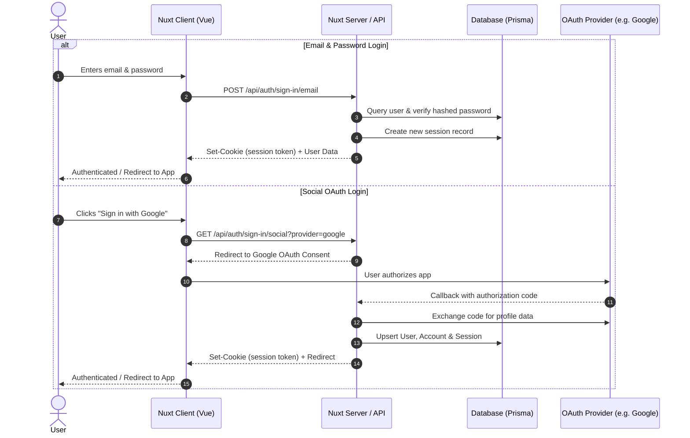

# Authentication and Better Auth

## Safely Storing Passwords

When a user registers or sets a password, it is crucial to store it securely. Instead of storing passwords directly, we use a process called hashing. Hashing converts a password into a fixed-length string of characters using a cryptographic algorithm. The resulting hash is unique to the input password, making it computationally infeasible to reverse-engineer the original password. Not all hashing algorithms are equally secure - some legacy algorithms (such as MD5 or SHA-1) are susceptible to collisions and fast brute-force computation on modern GPUs. Modern password hashing algorithms like **Argon2**, **scrypt**, or **bcrypt** are specifically designed to be computationally and memory intensive, slowing down brute-force attempts.

However, hashing alone is not enough to protect against attacks like dictionary attacks or rainbow table attacks where precomputed lists of password hashes are compared against a stolen database.

To enhance security, web applications use **salting**. Salting involves appending or prepending a unique, cryptographically random string of characters (the salt) to the password before hashing it. The salt is stored alongside the hashed password in the database. This ensures that two users with the identical password will have completely different hashes, neutralizing rainbow table attacks.

## Cookies and Sessions

Cookies are small pieces of data stored by the user's browser. They are commonly used for session management and authentication. When a user logs in, the server generates a cryptographically secure session token, creates a session record in the database, and sends the session token to the client as an HTTP cookie.

For robust security, authentication cookies should always use the following flags:
- `HttpOnly`: Prevents client-side JavaScript from accessing the cookie, mitigating Cross-Site Scripting (XSS) attacks.
- `Secure`: Ensures the cookie is only transmitted over encrypted HTTPS connections.
- `SameSite=Lax` (or `SameSite=Strict`): Protects against Cross-Site Request Forgery (CSRF) attacks by restricting when cookies are sent with cross-site requests.

## JSON Web Tokens (JWTs)

JWTs are self-contained, digitally signed tokens containing user identity information and claims. A JWT consists of three base64url-encoded parts separated by dots: header, payload, and signature.
- **Header**: Specifies the token type and signing algorithm (e.g., HMAC SHA256 or RSA/ECDSA).
- **Payload**: Contains claims such as user ID, email, role, and expiration timestamp (`exp`).
- **Signature**: Formed by signing the header and payload with a secret key or private key, guaranteeing token integrity.

While JWTs allow stateless verification without querying a database on every request, they have trade-offs: revoking an active JWT before it expires requires token blacklisting or keeping short lifetimes paired with refresh tokens. For most web applications, database-backed sessions with secure cookies provide easier revocation, session invalidation, and auditability.

## Encryption and Digital Signatures

Digital signing uses asymmetric (public-key) cryptography.

### Public and Private Keypairs

Public and private keypairs are generated together and are mathematically linked:
- **Public Key**: Shared openly with clients or third-party verifiers. It is used to encrypt data intended for the owner or to verify digital signatures created by the owner.
- **Private Key**: Kept strictly confidential by the server/owner. It is used to decrypt incoming messages encrypted with the public key or to sign outgoing data.

### Signing Data

To sign data, the sender uses their private key to generate a unique digital signature over the payload hash. The recipient or client uses the sender's public key to verify that the signature matches the payload. If the signature is valid, it proves:
1. **Authenticity**: The data originated from the private key holder.
2. **Integrity**: The data was not altered in transit.

## Methods for Transmitting Authentication Info

Authentication credentials or session identifiers can be sent in three primary ways:

### 1. Cookies (Recommended for Web Applications)
The session identifier is stored in an `HttpOnly`, `Secure` cookie. The browser automatically includes the cookie in same-origin HTTP requests, simplifying client-side logic and defending against token theft via XSS.

### 2. Authorization Header (Bearer Token)
The token is sent in the `Authorization` header using the Bearer scheme:
```http
Authorization: Bearer <session_token_or_jwt>
```
This method is standard for mobile apps, external API clients, and cross-domain requests.

### 3. Query Parameter
The token is appended to the URL (e.g., `https://example.com/verify?token=123456`). Query parameters should be reserved for one-time verification links (e.g., email verification or password resets) and never used for ongoing session transmission, as URLs can leak into browser history, logs, and `Referer` headers.

---

## Modern Authentication with Better Auth

At EPICS, we use **[Better Auth](https://www.better-auth.com/)** for authentication.

Better Auth is a TypeScript-first, self-hosted authentication framework built for modern full-stack web applications (including Nuxt, H3, Node.js, etc.). Unlike third-party hosted services like Auth0 where your users and auth logic live externally on a vendor's infrastructure, Better Auth runs directly within your application backend while persisting data directly in your database using **Prisma**.



### Why Better Auth?

1. **Complete Database Ownership**: All user tables, sessions, and credentials reside in your own database managed via Prisma migrations.
2. **Built-in Security**: Includes automated password hashing (via scrypt/argon2), secure cookie configuration, CSRF protection, and rate-limiting.
3. **Comprehensive Features**:
   - Email/password registration and sign-in
   - Social OAuth providers (Google, GitHub, Microsoft, Discord, etc.)
   - Session management with active device tracking and revocation
   - Two-Factor Authentication (2FA/TOTP)
   - Extensible plugins (Admin roles, Organizations, Bearer tokens, etc.)
4. **First-Class TypeScript & Vue Support**: Provides full type-safety from backend schema to Vue composables.

---

## Setting Up Better Auth with Nuxt and Prisma

### 1. Database Schema (`prisma/schema.prisma`)

Better Auth requires four core models in your Prisma schema: `User`, `Session`, `Account`, and `Verification`.

```prisma
datasource db {
  provider = "postgresql" // or "mysql", "sqlite"
  url      = env("DATABASE_URL")
}

generator client {
  provider = "prisma-client-js"
}

model User {
  id            String    @id @default(cuid())
  name          String
  email         String    @unique
  emailVerified Boolean   @default(false)
  image         String?
  createdAt     DateTime  @default(now())
  updatedAt     DateTime  @updatedAt

  sessions      Session[]
  accounts      Account[]

  // Application-specific relations can be linked here:
  // employeeProfile EmployeeProfile?
  // customerProfile CustomerProfile?

  @@map("user")
}

model Session {
  id        String   @id @default(cuid())
  userId    String
  user      User     @relation(fields: [userId], references: [id], onDelete: Cascade)
  token     String   @unique
  expiresAt DateTime
  ipAddress String?
  userAgent String?
  createdAt DateTime @default(now())
  updatedAt DateTime @updatedAt

  @@map("session")
}

model Account {
  id                    String    @id @default(cuid())
  userId                String
  user                  User      @relation(fields: [userId], references: [id], onDelete: Cascade)
  accountId             String
  providerId            String
  accessToken           String?
  refreshToken          String?
  accessTokenExpiresAt  DateTime?
  refreshTokenExpiresAt DateTime?
  scope                 String?
  idToken               String?
  password              String?
  createdAt             DateTime  @default(now())
  updatedAt             DateTime  @updatedAt

  @@map("account")
}

model Verification {
  id         String   @id @default(cuid())
  identifier String
  value      String
  expiresAt  DateTime
  createdAt  DateTime @default(now())
  updatedAt  DateTime @updatedAt

  @@map("verification")
}
```

Run `npx prisma migrate dev` or `npx prisma db push` to generate and apply the migration.

### 2. Server Configuration (`server/utils/auth.ts`)

Create the server-side Better Auth instance using the Prisma adapter:

```ts
// server/utils/auth.ts
import { betterAuth } from "better-auth";
import { prismaAdapter } from "better-auth/adapters/prisma";
import { PrismaClient } from "@prisma/client";

const prisma = new PrismaClient();

export const auth = betterAuth({
  database: prismaAdapter(prisma, {
    provider: "postgresql", // or "mysql", "sqlite"
  }),
  emailAndPassword: {
    enabled: true,
  },
  socialProviders: {
    google: {
      clientId: process.env.GOOGLE_CLIENT_ID as string,
      clientSecret: process.env.GOOGLE_CLIENT_SECRET as string,
    },
    github: {
      clientId: process.env.GITHUB_CLIENT_ID as string,
      clientSecret: process.env.GITHUB_CLIENT_SECRET as string,
    },
  },
});
```

### 3. Auth API Route Handler (`server/api/auth/[...all].ts`)

Mount Better Auth's HTTP request handler to handle all auth routes (`/api/auth/*`):

```ts
// server/api/auth/[...all].ts
export default defineEventHandler((event) => {
  return auth.handler(toWebRequest(event));
});
```

Better Auth automatically handles all endpoints for sign up, sign in, social redirects, callbacks, sign out, and session fetching under `/api/auth/*`.

### 4. Client-Side Auth Client (`lib/auth-client.ts` or `utils/auth-client.ts`)

Configure the client-side helper for Vue/Nuxt:

```ts
// utils/auth-client.ts
import { createAuthClient } from "better-auth/vue";

export const authClient = createAuthClient({
  baseURL: process.env.BETTER_AUTH_URL || "http://localhost:3000",
});

export const { signIn, signUp, signOut, useSession } = authClient;
```

---

## Verifying Authentication on the Server

To protect API routes and verify incoming requests, retrieve the session using `auth.api.getSession`:

```ts
// server/api/protected-data.get.ts
export default defineEventHandler(async (event) => {
  const session = await auth.api.getSession({
    headers: event.headers,
  });

  if (!session) {
    throw createError({
      statusCode: 401,
      statusMessage: "Unauthorized: Please log in first",
    });
  }

  return {
    message: "Access granted to protected data",
    user: session.user,
  };
});
```

You can also create a Nuxt server middleware (`server/middleware/auth.ts`) to annotate requests or enforce login across protected route patterns:

```ts
// server/middleware/auth.ts
export default defineEventHandler(async (event) => {
  if (event.path.startsWith("/api/protected")) {
    const session = await auth.api.getSession({
      headers: event.headers,
    });

    if (!session) {
      throw createError({
        statusCode: 401,
        statusMessage: "Unauthorized",
      });
    }

    event.context.user = session.user;
    event.context.session = session.session;
  }
});
```

---

## Using Authentication in Vue Components

### Registration & Login Component

```vue
<!-- components/LoginForm.vue -->
<template>
  <div class="login-container">
    <h2>Sign In</h2>

    <form @submit.prevent="handleEmailLogin">
      <div>
        <label>Email</label>
        <input v-model="email" type="email" required />
      </div>

      <div>
        <label>Password</label>
        <input v-model="password" type="password" required />
      </div>

      <button type="submit" :disabled="isLoading">
        {{ isLoading ? "Signing in..." : "Sign In" }}
      </button>
    </form>

    <div class="social-logins">
      <button @click="handleGoogleLogin" type="button">
        Sign in with Google
      </button>
      <button @click="handleGitHubLogin" type="button">
        Sign in with GitHub
      </button>
    </div>

    <p v-if="errorMessage" class="error">{{ errorMessage }}</p>
  </div>
</template>

<script setup>
import { ref } from "vue";
import { authClient } from "~/utils/auth-client";

const email = ref("");
const password = ref("");
const isLoading = ref(false);
const errorMessage = ref("");

const handleEmailLogin = async () => {
  isLoading.value = true;
  errorMessage.value = "";

  const { data, error } = await authClient.signIn.email({
    email: email.value,
    password: password.value,
    callbackURL: "/dashboard",
  });

  if (error) {
    errorMessage.value = error.message || "Failed to sign in";
  } else {
    await navigateTo("/dashboard");
  }

  isLoading.value = false;
};

const handleGoogleLogin = async () => {
  await authClient.signIn.social({
    provider: "google",
    callbackURL: "/dashboard",
  });
};

const handleGitHubLogin = async () => {
  await authClient.signIn.social({
    provider: "github",
    callbackURL: "/dashboard",
  });
};
</script>
```

### Accessing Current Session & Sign Out

```vue
<!-- components/UserProfile.vue -->
<template>
  <div v-if="session.data">
    <p>Welcome back, {{ session.data.user.name }} ({{ session.data.user.email }})</p>
    <button @click="handleSignOut">Sign Out</button>
  </div>
  <div v-else-if="session.isPending">
    <p>Loading session...</p>
  </div>
  <div v-else>
    <NuxtLink to="/login">Sign In</NuxtLink>
  </div>
</template>

<script setup>
import { authClient } from "~/utils/auth-client";

const session = authClient.useSession();

const handleSignOut = async () => {
  await authClient.signOut({
    fetchOptions: {
      onSuccess: () => {
        navigateTo("/login");
      },
    },
  });
};
</script>
```
